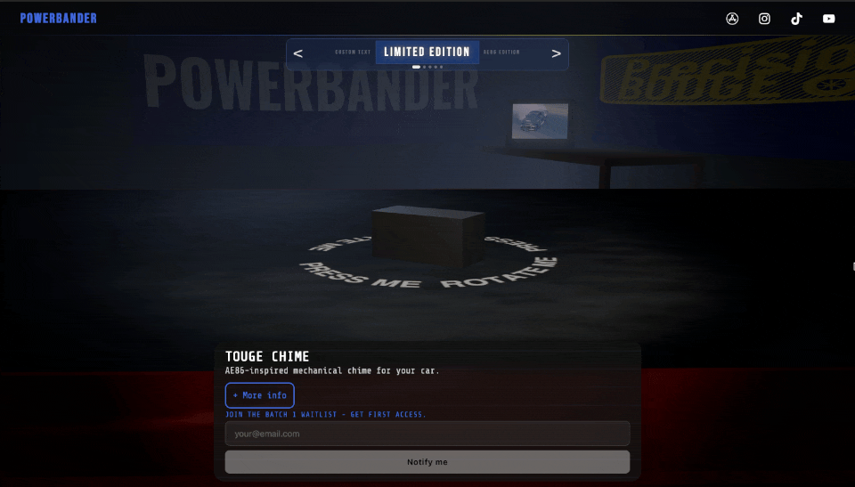
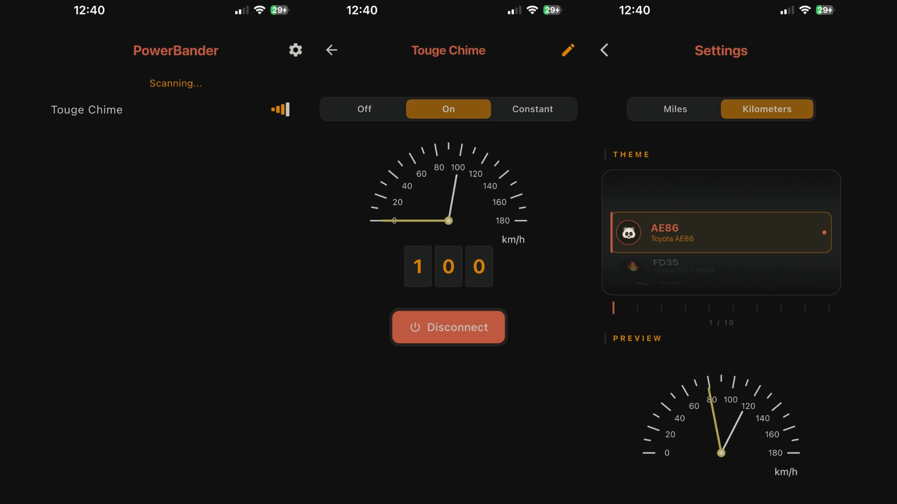
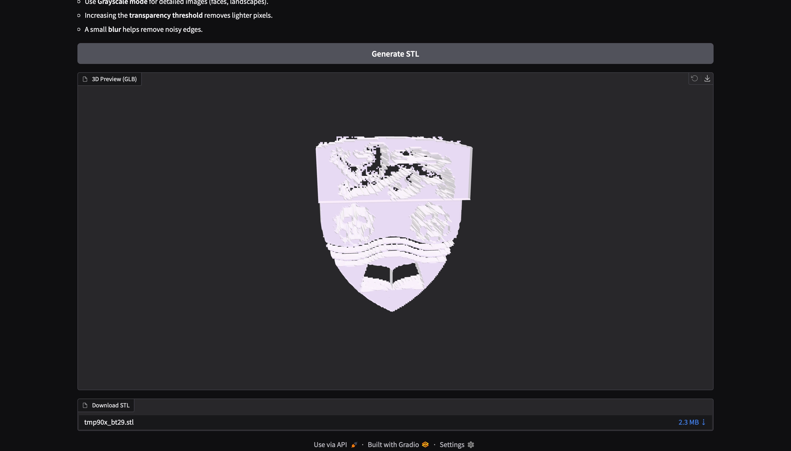
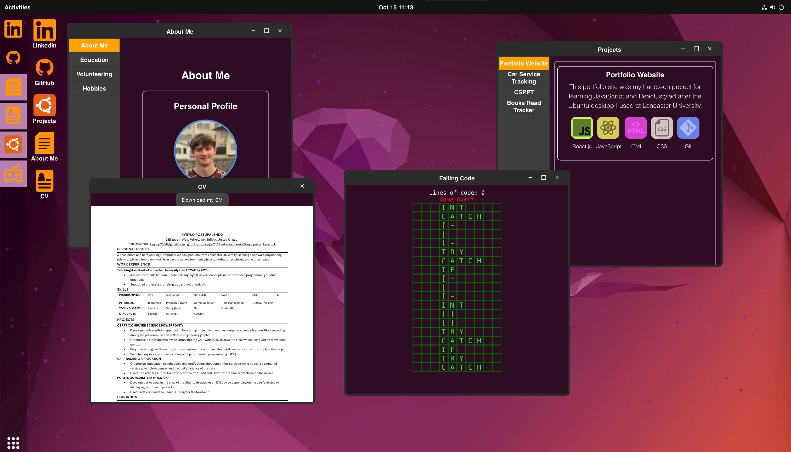
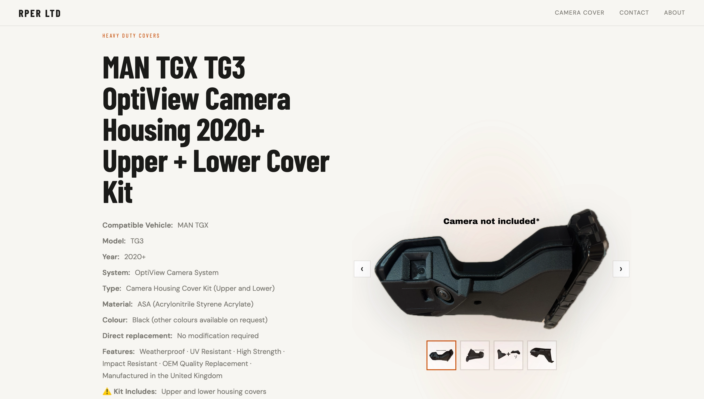

<h1 align="center">👋 Hi, I'm Kyrylo</h1>
<h3 align="center">MSc Computer Science @ St Andrews | Founder of &nbsp;</h3>

  <a href="https://kyrylo.uk">Website Portfolio</a> |
  <a href="https://www.linkedin.com/in/kyryloposty/">LinkedIn</a>

  
  
  

## About Me

- Focusing on **Low-Latency Systems**, **Artificial Intelligence**, and **Data Processing**.
- Founder of **[Touge Chime](https://powerbander.tech/)** — developing an embedded hardware product with **300+ Batch 1 email sign-ups**.
- Built and launched an iOS BLE app, a 3D e-commerce store, and self-hosted infrastructure. Reached **1k+ Instagram followers** and **1.5M+ organic views** across platforms.

## Personal Projects

### [Touge Chime](https://powerbander.tech/) 🔔

Engineered a modern recreation of the iconic Toyota AE86 mechanical speeding chime, combining custom hardware, embedded firmware, and precision-tuned acoustics.

  

  
  
  

- **Design & Prototyping:** Designed the enclosure in FreeCAD, hand-soldered prototypes, and fabricated chime plates using Audacity spectral analysis for precise frequency tuning.
- **Firmware & Embedded:** Programmed a dual-core ESP32 Mini to handle real-time GPS processing, solenoid pulse control, and BLE communication simultaneously.

---

### [3D Store](https://powerbander.tech/)

Built an interactive, garage-themed 3D e-commerce storefront with a custom Stripe payment backend.

  

  
  
  
  
  

- **3D Web Development:** Modelled and optimised the garage environment in Blender, implementing real-time lighting and interactions with Three.js.
- **DevOps & Infrastructure:** Self-hosted on a Raspberry Pi 4 running Linux behind Cloudflare Tunnels, with automated CI/CD deployments through GitHub Actions.

---

### [Official Touge Chime App](https://apps.apple.com/app/powerbander/id6762231997)

Published a cross-platform companion app providing real-time wireless control and configuration of the Touge Chime hardware.

  

  
  
  
  

- **Mobile Development:** Developed and published the Flutter app to the Apple App Store, implementing BLE connectivity for hardware pairing and control.
- **Protocol Design:** Engineered custom GATT services for live vehicle speed monitoring, speed threshold configuration, and chime operating modes.

---

### [Image to STL Converter](https://github.com/Kyrylo234/image_to_stl)

Developed a Python data processing pipeline that converts 2D image heightmaps into 3D-printable STL models.

  

  
  

- **Image Processing:** Applied Gaussian blurring and vectorised NumPy operations for noise reduction, surface smoothing, and 3D mesh generation.
- **Interactive Interface:** Built a Gradio UI for model visualisation and parameter tuning.

## Hackathon Projects

### [Git Happens](https://git-happens-peach.vercel.app)

**Hackathon Team Project (2 Developers) | My Role: Frontend Developer**

Collaborated with [Charlie Bloomfield](https://github.com/Charlie-Bloomfield) to build a GitHub analytics tool that ranks questionable commit habits through humorous achievements and interactive visualisations.

  

  
  
  
  

- **Frontend Development:** Built an interactive dashboard using Next.js, React, TypeScript, and Tailwind CSS to display contributor rankings, repository scores, and achievements.
- **Integration & Visualisation:** Connected the frontend to the team's repository analysis functionality and integrated dynamic SVG charts embeddable in GitHub READMEs.

[GitHub Repository](https://github.com/Charlie-Bloomfield/Git_Happens)

---

## Other Work

<table>
  <tr>
    <td width="50%" valign="top">
      <h3 align="center">Linux/iOS Themed Website Portfolio</h3>
      

      
Ubuntu/iOS-themed web desktop featuring an embedded Falling Blocks arcade game and persistent high scores.

      
<b>Tech:</b> React, Node.js, SQLite

      
<a href="https://github.com/Kyrylo234/Linux_portfolio_website">📂 GitHub Repo</a>

    </td>
    <td width="50%" valign="top">
      <h3 align="center">Commercial Work (RPER LTD)</h3>
      

      
Developed a web store for an engineering company.

    </td>
  </tr>
</table>
